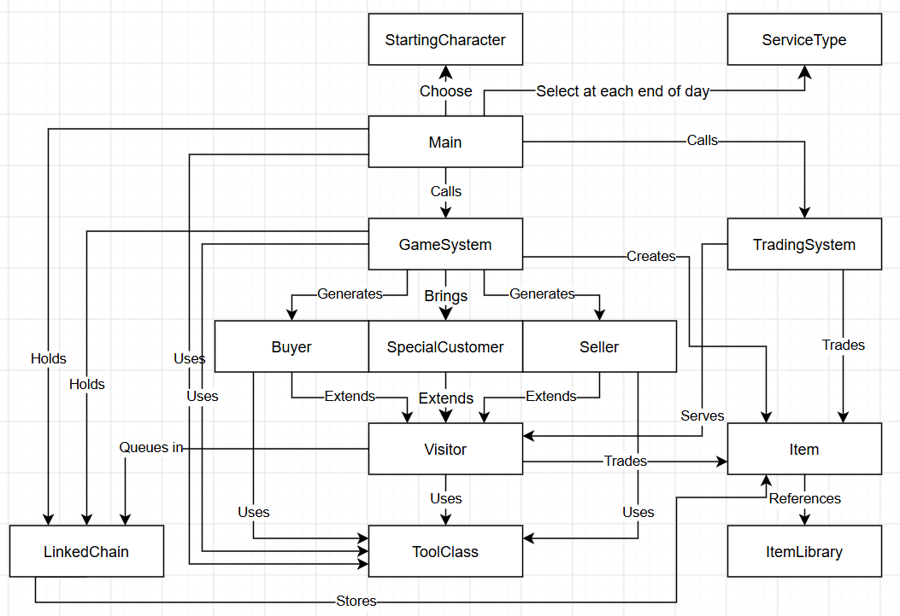

# Definitely Stolen README

Definitely Stolen is a Java console shopkeeper game set in a cyberpunk lower district. The player buys goods from scavengers, sells suitable goods to residents, manages inventory and coins, and pays weekly rent. This README explains how to run the prototype and tests, what changed from our specification, and what we plan to finish next.

Repository: https://github.com/nolan-ayodeji/CS2114-Project-2

Prototype reviewed: commit 674574b on main, October 16, 2026.

## System Diagram

## Compile and Run

### Requirements

Use JDK 17 and keep the repository folder structure intact. The source files are in src/DefinitelyStolenGame. The included lib/student.jar provides student.TestCase, JUnit 4.12, and the test runner used below. The verified environment was Windows with OpenJDK 17.0.9. A newer JDK may be incompatible with the older student testing library.

### Compile the Program

In Eclipse, choose File &gt; Import &gt; General &gt; Existing Projects into Workspace, select the cloned repository root, and finish the import. Use JDK 17 as the project JRE and confirm that lib/student.jar appears in the Java Build Path. Eclipse can then build the project automatically.

To compile from Windows PowerShell instead, open a terminal in the repository root. Make sure javac and java refer to JDK 17. Run these commands in order; they compile both the application and its tests:

New-Item -ItemType Directory -Path bin -Force | Out-Null

$sources = Get-ChildItem src/DefinitelyStolenGame -Filter *.java | ForEach-Object { $_.FullName }

javac -encoding UTF-8 -cp lib/student.jar -d bin $sources

### Run the Program

In Eclipse, right-click Main.java and select Run As &gt; Java Application. From PowerShell, run:

java -cp bin DefinitelyStolenGame.Main

Enter a shop name and select a starting character. Rookie starts with 500G, Scavenger starts with 350G and an extra Battery, and Merchant starts with 700G and 50G added to the initial rent. All characters receive two Chocolates, one Bandage, and one Toothpaste.

Open the shop, serve the waiting visitors, and close after the final visitor. There are five normal visitors each day. On every seventh day, the Landowner joins the end of the queue, making six visitors. Check Inventory and Check Coins return to the current shop menu. At a counter, enter item numbers separated by commas, such as 1,2,3; follow the displayed 0 and -1 options to buy all, review a sale, or return.

### Run the Tests

In Eclipse, right-click the DefinitelyStolenGame package and select Run As &gt; JUnit Test. Select the JUnit 4 runner if Eclipse asks. The tests use student.TestCase and public test methods, so they do not require @Test annotations.

After compiling, run all test classes from PowerShell with:

$tests = Get-ChildItem src/DefinitelyStolenGame -Filter *Test.java | ForEach-Object { "DefinitelyStolenGame." + $_.BaseName }

java -cp "bin;lib/student.jar" org.junit.runner.JUnitCore $tests

On October 16, all 24 Java source and test files compiled, and all 76 tests in 11 test classes passed. The final runner result was OK (76 tests). JDK 17 printed deprecation warnings from student.jar about System.setSecurityManager; the warnings did not fail the run. A separate console check also reached day 2 after serving five visitors and closing day 1, rejected blank names and invalid menu answers, and ended cleanly when input closed. That console check is not part of the committed JUnit suite.

## Reflection

### Changes from the Specification

Our specification described ten classes, a fixed 500G starting balance, a daily queue of buyers and sellers, and basic item prices. The prototype retains that structure and adds three types: SpecialCustomer, SCList, and StartingCharacter. The main changes are:

- We added SpecialCustomer to introduce the Landowner as a special visitor. The Landowner is a core game mechanic because failing to pay rent determines when the game ends. SpecialCustomer extends Visitor and stores a type from SCList. We added SCList to prepare for more special customers in our stretch goals; it currently contains only LANDOWNER. GameSystem.startDay(int day) adds the Landowner last on days divisible by seven, and getWaitingCount() includes that extra visitor. The original startDay() remains available and delegates to day 1. The new overload rejects nonpositive days with IllegalArgumentException.

- TradingSystem now routes SpecialCustomer visits to their own event. It stores the Landowner rent and one-time waiver separately from the generic SpecialCustomer class. Rent starts at 200G, rises by 10G after each successful payment, and receives a 50G initial increase for Merchant. The first unpaid visit is waived without arrears or a rent increase; the second unpaid visit ends the game. This structure allows later special customers to have different events without inheriting rent fields.

- StartingCharacter adds Rookie, Scavenger, and Merchant. Main.chooseCharacter() selects their starting resources. TradingSystem has a new constructor with an extraRent argument; its original two-argument constructor still works. Main.initializeInventory() now adds a Battery for Scavenger. These changes give players different starting conditions.

- We implemented one of our original stretch goals: authentic and counterfeit goods with an inspect feature. Item now tracks an authentic/counterfeit flag and an inspected flag, recording whether each item is genuine and whether the player has inspected it. It also tracks relabeling and has a new constructor that accepts the authenticity flag. GameSystem gives each generated seller item a 10 percent chance of being counterfeit. An inspected, unrelabelled counterfeit sells for 0.6 times its base value; other items sell for 1.2 times the base value, rounded. Item.toString() now returns the item name so Seller.getInventory() produces readable names. This also fixed the inventory-output test expectation.

- Main.displayDaySummary(int startingCoins) reports the balance change, remaining stock, and days until the next Landowner visit. Nolan also revised menu spacing and customer wording. The opening and closing event comments remain for future events.

- The test plan has become 11 executable test classes, including tests for the newer item states and starting characters. However, the current suite does not yet supply the planned normal and bad-input case for every public application method. Passing the existing suite therefore does not establish complete coverage.

Stephen was responsible for SpecialCustomer and SCList, as well as the trading and Landowner integration with GenAI assistance. Ryan was responsible for StartingCharacter, authentic and counterfeit items, and the inspect feature. Nolan revised the console layout and day summary. Stephen, Ryan, and Nolan worked together on the test methods. The attribution table gives the file-level contributions.

### Where Validation Lives

The main validation responsibilities still match the specification. TradingSystem.buyItems() validates ownership, duplicate object selections, and the entire price before transferring items or coins. If a purchase is unaffordable, it returns false; sellerCounter() prints an error and asks for another selection. Buying all remaining stock uses the rounded 70 percent wholesale price, including when the player explicitly selects every item. An unaffordable bulk purchase moves nothing.

TradingSystem.buyerCounter() refuses to list an unwanted item type and prints the buyer's rejection. sellItems() repeats the type and ownership checks before making a sale. If the total exceeds the buyer's budget, reviewSale() asks for confirmation before accepting the capped payment. Buyer.spend() rejects negative amounts or amounts above the remaining budget with IllegalArgumentException.

Both ToolClass.askOption() overloads re-prompt after out-of-range numbers or NumberFormatException. Blank input becomes an empty string and is handled by NumberFormatException, just like decimal or nonnumeric input; it does not cause NullPointerException. TradingSystem.parseSelection() checks comma-separated item numbers before the caller changes the selection. Main checks GameSystem.hasVisitors() before offering another visitor; nextVisitor() itself returns null when the chain is empty. Main also catches NoSuchElementException when console input ends.

### Changes to LinkedChain

We kept the supplied LinkedChain implementation unchanged and added only the package declaration DefinitelyStolenGame. No new storage methods or game rules were added. Its private Node class, head reference, and entry count remain hidden from the application.

The same LinkedChain&lt;T&gt; class stores Item objects in player inventories, seller inventories, purchases, and buyer listings, and Visitor objects in the daily queue. GameSystem uses addToEnd() and remove() to serve visitors in arrival order. Inventory operations use methods such as add(), contains(), remove(item), size(), and toArray(). Duplicate goods are allowed, and two separate Item objects with the same name remain separate physical goods. The game uses two declared element types; the String chain used in LinkedChainTest is a test fixture.

The specification's revised scope already switched inventory storage to LinkedChain. The current chain preserves its traversal order unless modified, but it does not automatically sort goods or group equal names. Numbered inventory displays use that traversal order.

### Method Complexity Compared with the Specification

Let v be the number of daily visitors, n the size of the relevant inventory, and k the number of selected or listed items. These costs describe computation and exclude the time a player spends entering answers.

| Method | Current cost | Comparison with the specification |
| --- | --- | --- |
| GameSystem.startDay | O(v²) | Matches the estimate: each addToEnd traverses the growing queue. The extra weekly visitor does not change the order. |
| GameSystem.nextVisitor | O(1) | Matches the estimate: remove takes the front node. hasVisitors and getWaitingCount are also O(1). |
| Seller.show and getWholesalePrice | O(n) | Each copies or visits the inventory once. getInventory is also O(n); the spec's O(2n) simplifies to O(n). |
| TradingSystem.buyItems and sellItems | O(nk + k²) | Membership checks and removals walk chains. When k is proportional to n, this matches the spec's O(n²) worst case. |
| TradingSystem displayInventory | O(n + nk) | Corrects the spec's linear estimate: each displayed item also searches the listing with contains(). Worst case is O(n²). |
| TradingSystem browseInventory | O(n) per list display | The initial array copy is O(n). Repeated menu visits add work, so the entire interaction has no fixed bound without an input count. |
| Item price and state methods | O(1) | The new inspect and relabel operations change fixed fields. Price calculations remain constant time. |

### Unknowns from the Scope

We have resolved how to reuse LinkedChain for both visitors and items and how to manage the main buying, selling, and daily shop flow. Our remaining unknowns concern the stretch goals: their numerical values, development priority, implementation difficulty, and effects on the game's economy and difficulty. We also need to determine whether we have enough time to add each feature. For example, material-processing values and nighttime service prices need to be balanced so they are useful without making rent and trading too easy.

### What Does Not Work Yet

The features required for our MVP are complete. The main unfinished features are stretch goals: processing raw materials into more valuable goods, services that the player can purchase at night, and additional special customers beyond the Landowner. Tool and shop upgrades and relocation to a more prosperous district are also not implemented.

The current 76 JUnit tests pass, but test coverage is not yet complete. Main and ToolClass lack dedicated tests, and the full interactive trading and weekly rent sequences need more coverage. The inspection menus also need minor input and return-navigation fixes, and the reduced counterfeit purchase price is not yet connected to the purchasing flow. These are remaining testing and refinement tasks alongside future feature development.

## Next Steps

### Remaining MVP Work and Team Responsibilities

All required MVP features have been implemented. Our next development work will focus on extending the game through stretch goals while improving tests and fixing issues found during playtesting.

- First, agree on the values and rules for processing raw materials and buying nighttime services, and choose small versions that fit the remaining time.
- Next, implement and test those features one at a time, checking their effects on inventory, coins, and the daily game loop.
- Then, add more special customers if time permits and test the complete game flow again.

Stephen, Ryan, and Nolan will divide feature implementation and test development equally. We will select individual tasks together according to workload and feature difficulty, and review each other's changes before combining them.

### Stretch Goals Committed or Dropped

- Implemented and retained: authentic and counterfeit goods, inspection, and relabeling. This fulfills one of our original stretch goals, with the remaining refinements described above.
- Implemented and retained: starting characters with different resources. The Landowner remains a core game mechanic, and SpecialCustomer and SCList provide a foundation for later special-customer extensions.
- Committed as our next development priorities: small versions of raw-material processing and purchasable nighttime services. We will finalize their prices, effects, and limits before implementing them.
- Conditional on available time: additional special customers and more opening or closing events. We will prioritize these after the processing and nighttime-service features.
- Dropped from the planned final submission: extensive tool and shop upgrade systems and relocation to another district. These may be reconsidered after the course project because they would require more design, balancing, and testing time.

### New Tests Needed

For every new public method, we will add a normal case and a bad-input or relevant boundary case. Planned tests include:

- Material processing: valid materials produce the expected goods and value; missing or insufficient materials reject the action without changing inventory or coins. If processing has a fee, test insufficient funds and exact payment as well.
- Nighttime services: purchasing an available service deducts the correct price and applies its effect once. Test insufficient funds, invalid choices, and any time or usage restrictions defined for the service.
- Additional special customers: test when each customer appears, the correct dialogue choices and event effects, and invalid choices or unmet event requirements. Confirm that these events preserve the normal visitor queue and the Landowner's schedule.
- Integration and balance: test that processing and services correctly update the existing LinkedChain inventory and coin balance, and that opening, closing, and rent payments still work after the new features are added.
- Existing coverage gaps: add normal and invalid-input tests for Main and ToolClass, transaction-menu tests, bulk-purchase rejection without partial transfers, and complete Landowner payment, waiver, and game-over tests. Keep the existing empty-chain and missing-removal tests as regression checks.

## Attribution

Stephen uses the commit name chens, Ryan uses ryank24-2026S, and Nolan uses nolan-ayodeji. Stephen was responsible for SpecialCustomer and SCList. Ryan was responsible for StartingCharacter, authentic and counterfeit items, and inspection. All three team members collaborated on the test methods, including work that is not separately visible in commit authorship. LinkedChain is credited to CS 2114 Staff as the supplied implementation.

| Class or test file | Contributors | Contribution |
| --- | --- | --- |
| Buyer.java | Stephen | Implemented buyer data and spending validation, with GenAI assistance on trading behavior. |
| GameSystem.java | Stephen; Ryan | Stephen implemented visitor generation, queue handling, and weekly scheduling with GenAI assistance. Ryan added counterfeit generation. |
| Item.java | Stephen; Ryan | Stephen implemented the base model and readable toString, with GenAI assistance. Ryan added authenticity, inspection, relabeling, and price rules. |
| ItemLibrary.java | Stephen | Created the catalog entries and their fields and getters. |
| LinkedChain.java | CS 2114 Staff; Stephen | Staff supplied the generic chain. Stephen imported it and added the package declaration; storage implementation is unchanged. |
| Main.java | Stephen; Ryan; Nolan | Stephen implemented the day loop and rent exit with GenAI assistance. Ryan integrated starting characters. Nolan added day summaries and revised the layout. |
| SCList.java | Stephen | Created the enum with GenAI assistance to support future special customers from our stretch goals; currently defines only the Landowner. |
| Seller.java | Stephen | Implemented stock access, wholesale pricing, and counter output with GenAI assistance. |
| ServiceType.java | Ryan | Implemented the nighttime service enum for stock insurance, overnight security, and advertising, including service names, prices, descriptions, and getters. |
| SpecialCustomer.java | Stephen | Created the Visitor subclass with GenAI assistance to add the Landowner and support the rent-based game-over mechanic. |
| StartingCharacter.java | Ryan | Added the three character definitions, balances, rent adjustments, and descriptions. |
| ToolClass.java | Stephen; Nolan | Stephen implemented input and menu helpers with GenAI assistance. Nolan revised menu presentation. |
| TradingSystem.java | Stephen; Ryan; Nolan | Stephen implemented trades, counter state, and the rent event with GenAI assistance. Ryan added inspection and character rent support. Nolan revised balance output. |
| Visitor.java | Stephen | Implemented shared visitor data and say(), including the null-message fallback, with GenAI assistance. |
| BuyerTest.java | Stephen; Ryan; Nolan | Collaborated on getter and spending tests, including negative and excessive spending. |
| GameSystemTest.java | Stephen; Ryan; Nolan | Collaborated on generation, waiting-count, day validation, and visitor-removal tests. |
| ItemAndCharacterTest.java | Stephen; Ryan; Nolan | Collaborated on authenticity, inspection, relabeling, character-resource, and constructor tests. |
| ItemLibraryTest.java | Stephen; Ryan; Nolan | Collaborated on tests for the four item definitions. |
| ItemTest.java | Stephen; Ryan; Nolan | Collaborated on item-state, price, and readable toString tests. |
| LinkedChainTest.java | Stephen; Ryan; Nolan | Collaborated on storage, ordering, null-input, index, array, empty-chain, and missing-removal tests. |
| SellerTest.java | Stephen; Ryan; Nolan | Collaborated on seller inventory, wholesale-price, and numbered-output tests and revisions. |
| SpecialCharacterTest.java | Stephen; Ryan; Nolan | Collaborated on the Landowner metadata and SpecialCustomer construction test. |
| StartingCharacterTest.java | Stephen; Ryan; Nolan | Collaborated on tests for each starting character. |
| TradingSystemTest.java | Stephen; Ryan; Nolan | Collaborated on transaction, rent-payment, budget, rejection, and inventory-output tests. |
| VisitorTest.java | Stephen; Ryan; Nolan | Collaborated on visitor-data and dialogue-output tests, including a null message. |

## GenAI Use

We refined this README with GenAI assistance to improve its accuracy and professionalism. We also used GenAI to review our test methods and check whether they covered all methods requiring tests. During development, we asked GenAI for advice on the program structure and used its debugging assistance to complete the prototype.
